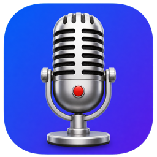
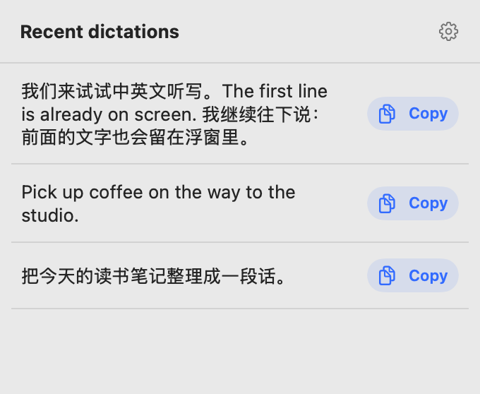

<p align="center"></p>
<h1 align="center">FreeTalking</h1>
<p align="center">Live dictation from your Mac menu bar.</p>
<p align="center"><a href="https://github.com/Jill0001/FreeTalking/releases/latest"><strong>Download for Apple Silicon</strong></a> · <a href="README.zh-CN.md">中文说明</a></p>

Tap **Right Command** and start speaking. A floating transcript grows near the cursor as words arrive from OpenAI. Tap again to copy the finished text or paste it directly into the app where you started.


This replay uses the actual updates from one session with synthesized Mandarin and English speech. Mandarin, English and switching between them are what we use most. Recognition has worked well in everyday use with these languages. Other languages have had less testing, and the app currently sends Chinese and English language hints.

## Install

Download the DMG for **Apple Silicon · macOS 15.2 or later**, drag FreeTalking into Applications and open it.

**First launch:** The release is locally signed and has not been notarized by Apple. If macOS says it cannot verify the developer, and you trust the copy you downloaded, go to **System Settings → Privacy & Security → Open Anyway** after the first launch attempt. Confirm **Open** for FreeTalking. [Apple’s illustrated guide](https://support.apple.com/en-us/102445)

## First dictation

1. Launch FreeTalking and click the microphone in the menu bar. Open the gear and select **Dictation**. Enter your OpenAI API key and click **Save Key**. Allow microphone access when prompted.
2. Press and release **Right Command** to start recording. Press it again to finish. Press **Esc** during recording to discard. Recording stops automatically at three minutes.
3. The live session finishes the last words and sends its final text to the clipboard. To paste automatically, enable **Auto-paste into active app** under **Output** and grant Accessibility permission.
4. Click the menu bar microphone to see your ten most recent dictations. Click a result to copy it. For new results, the waveform and document buttons reveal the available WAV recording and saved TXT transcript in Finder.



## Settings

- **Dictation** configures the API key, microphone and optional text near the cursor. When enabled and accessible, up to 200 characters of input context are sent with the session.
- **Output** controls automatic paste, optional text-file saving and media pausing. It also provides history cleanup, logs and Quit.
- **Shortcuts** configures start/finish, discard and clipboard-only recording.

## Requirements

- macOS 15.2 or later
- An OpenAI API key with access to live transcription

For local source builds, install the media-control helper before building:

```sh
brew install media-control
```

## Local build

This is a locally maintained build with no automatic update service. Build it
from source in Xcode, or use `./Scripts/local-dmg-build.sh` to create a local
drag-to-Applications DMG.

## Audio lifecycle checks

Run `bash Tests/check_audio_lifecycle.sh` for hardware-independent regression
checks. They cover blocked initialization and shutdown, cancellation, duplicate
starts, recovery after failure, and completion after a timeout. Synthetic audio
checks verify buffer ownership, complete resampling, and file closure before
transcription. Test artifacts stay in `tmp/audio-lifecycle`.

Audio setup and shutdown run on a serial background queue. A ten-second timeout
reports an unresponsive microphone while the UI remains available. The app waits
for the outstanding operation and cleanup before allowing another recording.
A system call that never returns still requires restarting the app. Each capture
logs its session ID and the beginning, end, and duration of device selection,
engine preparation, startup, shutdown, and file finalization.

Hardware validation should include repeated start/stop, cancelling startup,
changing the default microphone, disconnecting a selected microphone, Bluetooth
reconnection, and recording after sleep/wake. Automated checks do not reproduce
CoreAudio or driver-specific hangs.

## Privacy & Storage

- Each recording uses a separate temporary WAV file, available in Finder while the temporary file exists. Discarded and empty recordings are removed.
- Transcription history (last 10 items) and the API key are stored in UserDefaults
- Logs are written to `~/Library/Application Support/FreeTalking/FreeTalking.log`

## License

FreeTalking is based on [Ramblr](https://github.com/nfarina/ramblr) by Nick Farina. See the [MIT license](LICENSE.txt).
