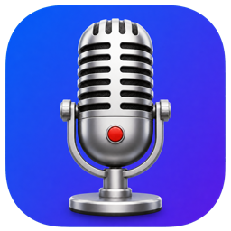
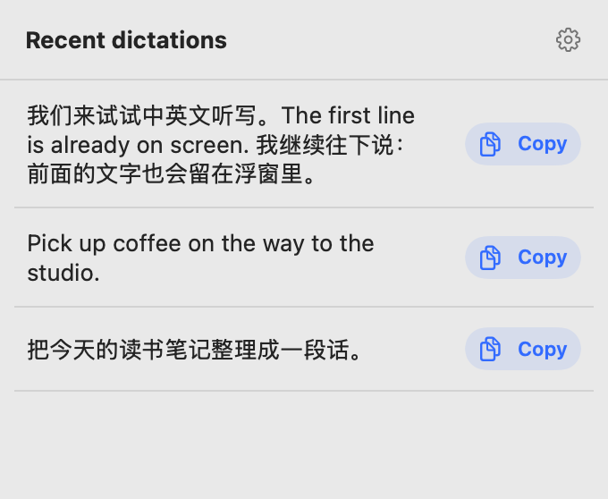

<h1 align="center">FreeTalking</h1>

在 Mac 菜单栏开启听写，边说边看文字。

<a href="https://github.com/Jill0001/FreeTalking/releases/latest"><strong>下载 Apple 芯片版</strong></a> · <a href="README.md">English</a>

按一下**右侧 Command** 开始说话，转写文字会逐步出现在光标附近的浮窗里。长句自动换行，前文保留下来。再按一下结束，整段文字就可以复制，也可以自动粘贴到刚才的输入框。

这段 GIF 回放了一次中英混说听写，用合成语音作为输入，按实际收到转写结果的时间展示。我们平时用得最多的是普通话、英语和中英混说，日常听写的识别效果不错。其他语言实测较少，目前应用会向模型提供中文和英文两种语言提示。

## 第一次使用

从上方下载 DMG，适用于 **Apple 芯片、macOS 15.2 或更高版本**。把 FreeTalking 拖进「应用程序」后打开。

**如果首次启动提示「无法验证开发者」**：当前版本使用本地签名，未经 Apple 公证。首次尝试打开后，如果你信任下载的副本，可前往「系统设置 → 隐私与安全性」，找到 FreeTalking，点击「仍要打开」并确认。[Apple 图文说明](https://support.apple.com/en-us/102445)

1. 首次录音时，按系统提示允许使用麦克风。
2. 点击菜单栏麦克风，再点齿轮 → **Dictation**。输入自己的 OpenAI API Key，点 **Save Key**。可在同一页测试连接、选择麦克风、设置光标附近文本作为识别参考。[获取 OpenAI API Key](https://platform.openai.com/api-keys)
3. **Output** 可以开启自动粘贴、保存 TXT 或录音时暂停媒体。**Shortcuts** 可以修改快捷键。
4. 菜单栏展示最近 10 条听写。点击文字可复制；新录音旁的波形与文档按钮可在 Finder 中显示仍存在的 WAV 和已保存的 TXT。

## 录第一段话

| 想做什么 | 默认操作 |
|---|---|
| 开始录音 | 按一下并松开键盘**右侧 Command（⌘）**，然后说话。浮窗会随语音出字。 |
| 结束并保留 | 再按一下并松开**右侧 ⌘**。等待浮窗收完尾音后，默认按 **⌘V** 粘贴结果；启用自动粘贴时，结果直接进入当前输入框。 |
| 中途丢弃 | 录音中按 **Esc**。这次录音会结束，不输出文字。 |
| 回看前文 | 长段口述会自动换行。浮窗达到高度上限后，用鼠标或触控板向上滚动；滚回底部会继续跟随新字。 |

## 阅读与构建源码

- 在 Windows 或 Linux 上解压 ZIP，就能用编辑器阅读全部源码。Release 中的 DMG 和 Xcode 工程用于 macOS。开发其他平台的版本时，可沿用下文的实时协议流程，并替换桌面系统接口。
- 在 Mac 上从源码构建，先安装完整 Xcode 和 Homebrew 的 `media-control`（`brew install media-control`），再打开 [Xcode 工程](Ramblr.xcodeproj) 运行 Ramblr scheme。工程名沿用 Ramblr，产物名为 FreeTalking。也可以在仓库根目录下执行 `bash Scripts/local-dmg-build.sh` 打包。FreeTalking 基于 [Ramblr](https://github.com/nfarina/ramblr) 开发，保留了原项目的 [MIT 许可证](LICENSE.txt)。

## 沿一次听写读源码

1. **谁决定开始、结束和丢弃？** [HotkeyManager](Ramblr/HotkeyManager.swift) 将键盘事件转成动作。[RecordingCoordinator](Ramblr/RecordingCoordinator.swift) 协调麦克风准备、录音、等待最终稿和输出。本次录音有独立的标识，晚到的预览事件会核对标识再更新窗口。默认 Esc 采用被动监听，因此前台应用也会收到它。
2. **如何让录音和上传并行？** [AudioCaptureEngine](Ramblr/AudioCaptureEngine.swift) 在麦克风回调中复制缓冲区，再交给后台串行队列处理，以免设备复用缓冲区后覆盖旧采样。同一份声音分两路：本机写 16 kHz 单声道 WAV，Live 会话从麦克风采样连续转换成 24 kHz 单声道 PCM16。每次录音各自持有转换器，连续音频块可以共享重采样状态。
3. **为什么连续说话也会出字？** [LivePreview](Ramblr/LivePreview.swift) 每次录音只建立一条转写 WebSocket。会话就绪后，通常积累约 100 毫秒音频便发送一次 `input_audio_buffer.append`。只有上一次发送结束才发送下一批，服务端返回的 `delta` 追加到同一份预览。这个发送粒度决定传输节奏，整句话可以跨越许多音频块。
4. **怎样收全最后几个字？** 停录时先排空录音队列和重采样器，把最后不足一批的音频发完，再发送 `input_audio_buffer.commit`。收到 `completed` 后，协调器把同一份最终文本交给浮窗和输出逻辑。正常 Live 听写只走这一个模型；如果收尾失败，用户可以在 Finder 中取回录音。Esc 会关闭会话并丢弃录音，已经发出的音频可能产生费用。
5. **长段文字如何显示？** [WaveformIndicatorWindow](Ramblr/WaveformIndicatorWindow.swift) 用不抢焦点的面板承载完整文本，按实际排版高度增长。达到屏幕可用高度的 65% 后，文本区纵向滚动。更新前先判断阅读位置是否贴近底部：贴近底部就跟随新字，向上翻阅时保留当前位置。[RecordingIndicatorPlacement](Ramblr/RecordingIndicatorPlacement.swift) 从辅助功能接口取得光标或输入框位置，并把浮窗限制在屏幕内。
6. **怎样粘回原来的应用？** [TranscriptionManager](Ramblr/TranscriptionManager.swift) 处理历史、复制和自动粘贴。自动粘贴先写系统剪贴板，再向前台应用发送粘贴快捷键。完成后保留剪贴板里的文本，让稍晚才读取剪贴板的编辑器也能取得同一份内容。

## 移植时的边界

最容易单独复现的是实时转写流程：保持单条连接、按顺序发送 PCM16、增量更新预览、停录后提交尾包、使用服务端最终文本。录音设备接入、全局快捷键、光标定位、不抢焦点的浮窗和跨应用粘贴都需要目标操作系统的实现。做第一个跨平台原型时，先用文件或麦克风送入 PCM 并显示增量文本，就可以独立验证协议，再接桌面交互。

[Tests](Tests) 有录音生命周期、缓冲区、光标定位、上下文和粘贴相关检查。例如，在 Mac 上进入仓库根目录后，可运行 `bash Tests/check_audio_lifecycle.sh` 检查设备启动、取消、超时和音频收尾。
